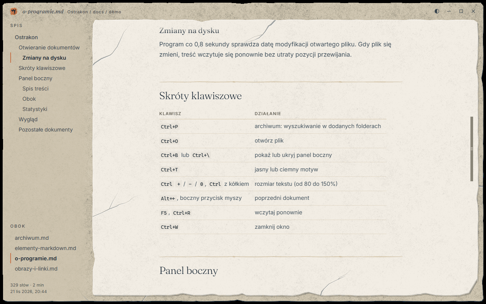
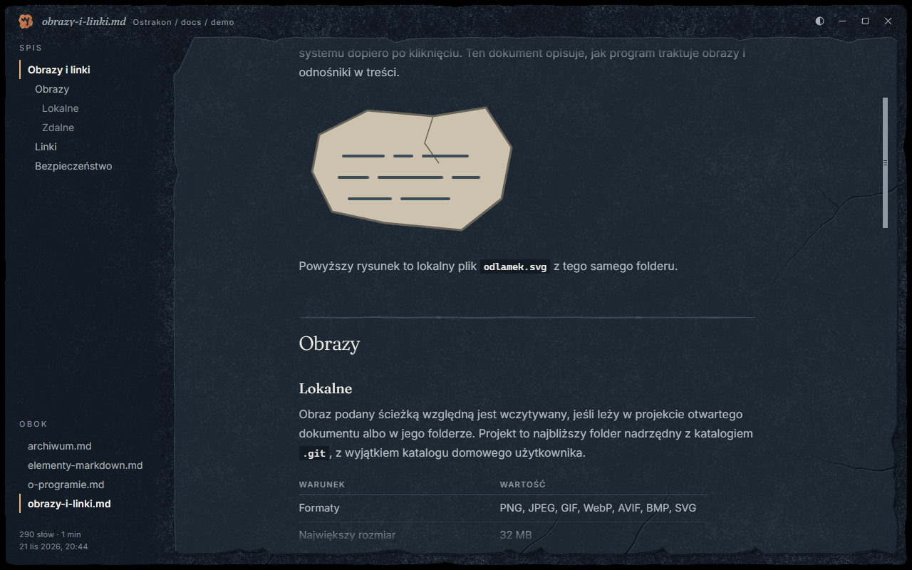
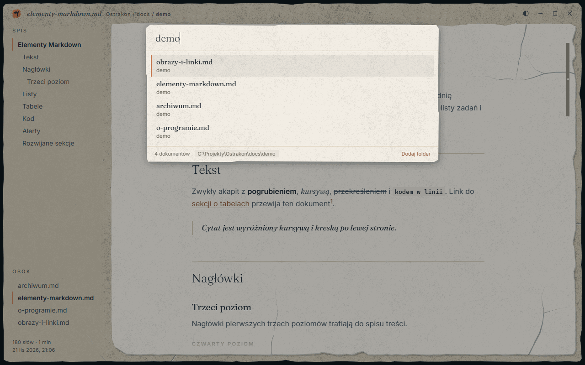

# Ostrakon

Ostrakon is a read-only Markdown viewer for Windows. It shows a document as text carved into a piece of stone and lets you search the Markdown files in folders you choose.



The user interface is in Polish. Ostrakon runs on Windows and renders through Microsoft Edge WebView2.

Made by Marcin Olszewski, [orphalese.pl](https://orphalese.pl).

## Features

- Opens `.md`, `.markdown`, `.mdown`, `.mkd` and `.mdx` files up to 16 MB: by double-click when set as the default program, with `Ctrl+O`, or by dropping a file onto the window.
- Renders CommonMark with GitHub extensions: tables with column alignment, footnotes, strikethrough, task lists (read-only) and alerts (`[!NOTE]`, `[!TIP]`, `[!IMPORTANT]`, `[!WARNING]`, `[!CAUTION]`). Code blocks show their language name; there is no syntax highlighting.
- Shows a YAML front matter block as a metadata card above the text (flat `key: value` pairs and simple lists).
- Side panel: a table of contents built from headings of levels 1 to 3, with the current section marked; the other Markdown files in the same folder; word count, reading time and the file's modification date.
- Reloads the open document when the file changes on disk (checked every 0.8 s), keeping the scroll position.
- Archive (`Ctrl+P`): searches file and folder names of all Markdown files in the folders you add. The search ignores case and Polish diacritics. Without a query it lists the last eight opened documents.
- Relative links to other Markdown files open in Ostrakon; `Alt+←` returns to the previous document.
- Light and dark theme (`Ctrl+T`), text size from 80 to 150% (`Ctrl` with `+`, `-`, `0` or the mouse wheel).
- Every document gets its own, stable pattern of cracks and chips, computed from its path.





### Keyboard shortcuts

| Key | Action |
|---|---|
| `Ctrl+P` | archive |
| `Ctrl+O` | open a file |
| `Ctrl+B`, `Ctrl+\` | show or hide the side panel |
| `Ctrl+T` | light or dark theme |
| `Ctrl` `+` / `-` / `0`, `Ctrl` + wheel | text size |
| `Alt+←`, mouse back button | previous document |
| `F5`, `Ctrl+R` | reload |
| `Ctrl+W` | close |

Sample documents that show the rendered elements are in [`docs/demo/`](docs/demo/) (in Polish).

## Security model

- Documents are only read, never written.
- HTML in a document is cleaned by the [ammonia](https://crates.io/crates/ammonia) sanitizer: scripts, frames, forms, styles, event attributes and links with schemes other than `http`, `https` and `mailto` are removed. Ids coming from a document get a `user-content-` prefix, so they cannot collide with the interface.
- A Content Security Policy (`default-src 'none'`, scripts and styles only from the application) is a second, independent layer.
- The interface has no file system, shell, HTTP or opener permissions. It can only call the application's own commands, which open Markdown files, resolve relative links and manage the archive folders.
- Remote images are blocked and replaced with a note, so a document cannot use tracking pixels. Local images are served only if they lie inside the document's project (the nearest parent folder containing `.git`, never the user's home folder) or in the document's folder: PNG, JPEG, GIF, WebP, AVIF, BMP and SVG up to 32 MB. SVG files are shown through ``, where their scripts do not run.
- UNC network paths are rejected before the disk is touched.
- The window cannot navigate to another address.
- Ostrakon makes no network connections of its own. `http`, `https` and `mailto` links are passed to the system browser or mail program only after a click. There is no telemetry and no automatic update.

## Data stored on disk

- `%APPDATA%\pl.orphalese.ostrakon\config.json`: the list of archive folders.
- `%APPDATA%\pl.orphalese.ostrakon\archive.json`: the archive index (name, path, folder and modification date of each Markdown file found; not the content).
- WebView2 `localStorage`: theme, text size, the hidden side panel, and the last eight opened documents (name, path and folder).
- The WebView2 profile in `%LOCALAPPDATA%\pl.orphalese.ostrakon\EBWebView`.

The installer registers the file associations under `HKCU\Software\Classes` (ProgID `Ostrakon.Markdown`) and the uninstall entry under `HKCU`. The uninstaller removes the program, the shortcuts and the file associations. It deletes the data listed above only when you tick the option to delete application data, which is unticked by default.

## Building from source

There is no ready-made installer to download. You build it yourself.

Requirements:

- Windows with WebView2 (the installer downloads WebView2 from Microsoft only if it is missing).
- Rust with the MSVC toolchain.
- Node.js and pnpm.
- [uv](https://docs.astral.sh/uv/), only for `pnpm assets`.

Versions used by the repository: Tauri 2.12.5, `@tauri-apps/cli` 2.12.4, pulldown-cmark 0.13.6, ammonia 4.2.5 (see `Cargo.lock` and `pnpm-lock.yaml`). Tested with Rust 1.99.1, Node 24.22.1, pnpm 10.33.2 and uv 0.8.12.

```powershell
pnpm install
pnpm tauri dev          # development window
pnpm build              # release build and NSIS installer
cd src-tauri; cargo test --lib
pnpm assets             # regenerates textures and icons (scripts/make_assets.py)
```

The installer is written to `src-tauri/target/release/bundle/nsis/`, or to `release/bundle/nsis/` inside `CARGO_TARGET_DIR` if you set it. If the project path is very long, the MSVC linker can hit the 260-character limit (`LNK1104`); set `CARGO_TARGET_DIR` to a short folder.

The resulting `.exe` files are not signed. Windows SmartScreen may warn before running the installer, and an antivirus may hold unsigned executables in a sandbox. For example, Avast's Autosandbox can stop the build scripts, the program or the installer without a message, and the process then hangs at 0 s CPU time. Exceptions for the specific files help.

## Known limitations

- Windows only. The project is built and tested on Windows with WebView2.
- The interface is in Polish only.
- The archive is scanned again at every start, with no time limit. It goes at most 9 levels deep and stops at 20,000 files.
- The archive skips folders whose name starts with a dot and common build and dependency folders (`node_modules`, `target`, `dist` and others), but not folders that are hidden only by the Windows attribute, such as `AppData`. Do not add your whole home folder.
- After a jump in the scroll position without scrolling through the document (for example `Alt+←` or a reload), the highlighted entry in the table of contents can stay on the previous section until you scroll.

## License

The code is released under the MIT License, see [`LICENSE`](LICENSE). The shard mark, the application icons and the Orphalese name and mark are not covered by it; see [`BRAND.md`](BRAND.md). The fonts Fraunces and Inter in `src/fonts/` are under the SIL Open Font License 1.1 (`src/fonts/LICENSE-fraunces.txt`, `src/fonts/LICENSE-inter.txt`).

---

# Ostrakon (po polsku)

Ostrakon to przeglądarka plików Markdown dla Windows, która tylko czyta dokumenty. Pokazuje dokument jako tekst wyryty w kamieniu i pozwala przeszukiwać pliki Markdown w wybranych folderach.

Interfejs jest po polsku. Ostrakon działa na Windows i wyświetla treść przez Microsoft Edge WebView2. Zrzuty ekranu są na początku tego pliku.

Autor: Marcin Olszewski, [orphalese.pl](https://orphalese.pl).

## Funkcje

- Otwiera pliki `.md`, `.markdown`, `.mdown`, `.mkd` i `.mdx` do 16 MB: dwuklikiem, gdy jest programem domyślnym, skrótem `Ctrl+O` albo po przeciągnięciu pliku na okno.
- Renderuje CommonMark z rozszerzeniami GitHub: tabele z wyrównaniem kolumn, przypisy, przekreślenia, listy zadań (tylko do odczytu) i alerty (`[!NOTE]`, `[!TIP]`, `[!IMPORTANT]`, `[!WARNING]`, `[!CAUTION]`). Bloki kodu pokazują nazwę języka; kolorowania składni nie ma.
- Blok YAML na początku pliku (front matter) pokazuje jako kartę z metadanymi nad tekstem (proste pary `klucz: wartość` i listy).
- Panel boczny: spis treści z nagłówków poziomów 1–3 z zaznaczoną bieżącą sekcją, pozostałe pliki Markdown z tego samego folderu, liczba słów, czas czytania i data zmiany pliku.
- Wczytuje dokument ponownie, gdy plik zmieni się na dysku (sprawdzanie co 0,8 s), bez utraty pozycji przewijania.
- Archiwum (`Ctrl+P`): wyszukiwanie po nazwach plików i folderów wszystkich plików Markdown w dodanych folderach. Wielkość liter i polskie znaki nie mają znaczenia. Bez zapytania pokazuje osiem ostatnio otwartych dokumentów.
- Względne linki do innych plików Markdown otwierają się w Ostrakonie; `Alt+←` wraca do poprzedniego dokumentu.
- Jasny i ciemny motyw (`Ctrl+T`), rozmiar tekstu od 80 do 150% (`Ctrl` z `+`, `-`, `0` albo kółkiem myszy).
- Każdy dokument ma własny, stały układ pęknięć i wyszczerbień, wyliczony z jego ścieżki.

### Skróty klawiszowe

| Klawisz | Działanie |
|---|---|
| `Ctrl+P` | archiwum |
| `Ctrl+O` | otwórz plik |
| `Ctrl+B`, `Ctrl+\` | pokaż lub ukryj panel boczny |
| `Ctrl+T` | jasny lub ciemny motyw |
| `Ctrl` `+` / `-` / `0`, `Ctrl` + kółko | rozmiar tekstu |
| `Alt+←`, boczny przycisk myszy | poprzedni dokument |
| `F5`, `Ctrl+R` | wczytaj ponownie |
| `Ctrl+W` | zamknij |

Przykładowe dokumenty z renderowanymi elementami są w [`docs/demo/`](docs/demo/).

## Model bezpieczeństwa

- Dokumenty są tylko czytane, nigdy zapisywane.
- HTML w dokumencie czyści sanitizer [ammonia](https://crates.io/crates/ammonia): usuwa skrypty, ramki, formularze, style, atrybuty zdarzeń i linki ze schematami innymi niż `http`, `https` i `mailto`. Identyfikatory z treści dostają prefiks `user-content-`, więc nie kolidują z interfejsem.
- Content Security Policy (`default-src 'none'`, skrypty i style tylko z aplikacji) to druga, niezależna warstwa.
- Interfejs nie ma uprawnień do systemu plików, powłoki, HTTP ani otwierania programów. Może wywoływać tylko własne komendy aplikacji, które otwierają pliki Markdown, rozwiązują linki względne i zarządzają folderami archiwum.
- Zdalne obrazy są blokowane i zastępowane notką, więc dokument nie może użyć pikseli śledzących. Lokalne obrazy są wczytywane tylko z projektu dokumentu (najbliższy folder nadrzędny z `.git`, nigdy katalog domowy) albo z folderu dokumentu: PNG, JPEG, GIF, WebP, AVIF, BMP i SVG do 32 MB. Pliki SVG są wyświetlane przez ``, gdzie ich skrypty się nie wykonują.
- Ścieżki sieciowe UNC są odrzucane, zanim program dotknie dysku.
- Okno nie może przejść na inny adres.
- Ostrakon sam nie łączy się z siecią. Linki `http`, `https` i `mailto` przekazuje do przeglądarki lub programu pocztowego systemu dopiero po kliknięciu. Nie ma telemetrii ani automatycznych aktualizacji.

## Dane zapisywane na dysku

- `%APPDATA%\pl.orphalese.ostrakon\config.json`: lista folderów archiwum.
- `%APPDATA%\pl.orphalese.ostrakon\archive.json`: indeks archiwum (nazwa, ścieżka, folder i data zmiany każdego znalezionego pliku Markdown; bez treści).
- `localStorage` WebView2: motyw, rozmiar tekstu, ukrycie panelu bocznego i osiem ostatnio otwartych dokumentów (nazwa, ścieżka i folder).
- Profil WebView2 w `%LOCALAPPDATA%\pl.orphalese.ostrakon\EBWebView`.

Instalator rejestruje skojarzenia plików w `HKCU\Software\Classes` (ProgID `Ostrakon.Markdown`) i wpis odinstalowania w `HKCU`. Deinstalator usuwa program, skróty i skojarzenia plików. Powyższe dane usuwa tylko po zaznaczeniu opcji usunięcia danych aplikacji, która domyślnie jest odznaczona.

## Budowanie ze źródeł

Nie ma gotowego instalatora do pobrania. Instalator budujesz sam.

Wymagania:

- Windows z WebView2 (instalator pobiera WebView2 od Microsoftu tylko wtedy, gdy go brakuje).
- Rust z zestawem narzędzi MSVC.
- Node.js i pnpm.
- [uv](https://docs.astral.sh/uv/), tylko do `pnpm assets`.

Wersje używane w repozytorium: Tauri 2.12.5, `@tauri-apps/cli` 2.12.4, pulldown-cmark 0.13.6, ammonia 4.2.5 (zob. `Cargo.lock` i `pnpm-lock.yaml`). Testowane z Rust 1.99.1, Node 24.22.1, pnpm 10.33.2 i uv 0.8.12.

```powershell
pnpm install
pnpm tauri dev          # okno deweloperskie
pnpm build              # build release i instalator NSIS
cd src-tauri; cargo test --lib
pnpm assets             # generuje faktury i ikony (scripts/make_assets.py)
```

Instalator trafia do `src-tauri/target/release/bundle/nsis/` albo do `release/bundle/nsis/` w `CARGO_TARGET_DIR`, jeśli go ustawisz. Przy bardzo długiej ścieżce projektu linker MSVC może przekroczyć limit 260 znaków (`LNK1104`); wtedy ustaw `CARGO_TARGET_DIR` na krótki folder.

Zbudowane pliki `.exe` nie są podpisane. Windows SmartScreen może ostrzec przed uruchomieniem instalatora, a antywirus może zatrzymać niepodpisane pliki w piaskownicy. Przykładowo Autosandbox Avasta potrafi bez komunikatu zatrzymać skrypty buildu, program albo instalator; proces wisi wtedy z 0 s czasu procesora. Pomagają wyjątki dla konkretnych plików.

## Znane ograniczenia

- Tylko Windows. Projekt jest budowany i testowany na Windows z WebView2.
- Interfejs jest tylko po polsku.
- Archiwum jest skanowane od nowa przy każdym starcie, bez limitu czasu. Skanowanie schodzi najwyżej 9 poziomów w głąb i zatrzymuje się na 20 000 plików.
- Archiwum pomija foldery, których nazwa zaczyna się od kropki, oraz typowe foldery buildów i zależności (`node_modules`, `target`, `dist` i inne), ale nie foldery ukryte tylko atrybutem Windows, na przykład `AppData`. Nie dodawaj całego katalogu domowego.
- Po skoku pozycji przewijania bez przewijania dokumentu (na przykład `Alt+←` albo ponowne wczytanie) zaznaczenie w spisie treści może zostać na poprzedniej sekcji, dopóki nie przewiniesz.

## Licencja

Kod jest udostępniony na licencji MIT, zob. [`LICENSE`](LICENSE). Znak odłamka, ikony programu oraz nazwa i znak Orphalese nie są nią objęte; zob. [`BRAND.md`](BRAND.md). Fonty Fraunces i Inter w `src/fonts/` są na licencji SIL Open Font License 1.1 (`src/fonts/LICENSE-fraunces.txt`, `src/fonts/LICENSE-inter.txt`).
