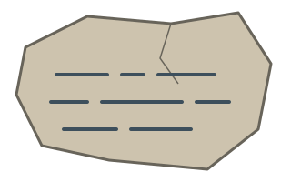

# Obrazy i linki

Ostrakon sam nie łączy się z siecią: adresy internetowe przekazuje do przeglądarki systemu dopiero po kliknięciu. Ten dokument opisuje, jak program traktuje obrazy i odnośniki w treści.



Powyższy rysunek to lokalny plik `odlamek.svg` z tego samego folderu.

## Obrazy

### Lokalne

Obraz podany ścieżką względną jest wczytywany, jeśli leży w projekcie otwartego dokumentu albo w jego folderze. Projekt to najbliższy folder nadrzędny z katalogiem `.git`, z wyjątkiem katalogu domowego użytkownika.

| Warunek | Wartość |
|:--|:--|
| Formaty | PNG, JPEG, GIF, WebP, AVIF, BMP, SVG |
| Największy rozmiar | 32 MB |
| Ścieżki bezwzględne i sieciowe (UNC) | odrzucane |

Plik SVG jest wyświetlany jako obraz, więc ewentualne skrypty w jego wnętrzu się nie wykonują.

### Zdalne

Obrazy z adresów `http` i `https` są blokowane, a w ich miejscu pojawia się notka. Dzięki temu dokument nie może zdradzić przez piksel śledzący, że ktoś go otworzył.


## Linki

| Rodzaj odnośnika | Co się dzieje po kliknięciu |
|:--|:--|
| `#sekcja` | przewinięcie do nagłówka w tym dokumencie |
| `inny.md` | otwarcie pliku Markdown w Ostrakonie |
| `http`, `https`, `mailto` | otwarcie w przeglądarce lub programie pocztowym systemu |
| inne schematy, na przykład `file:` | zablokowane, z komunikatem |
| inne pliki niż Markdown | zablokowane, z komunikatem |

Przykłady: [przejście do sekcji Bezpieczeństwo](#bezpieczeństwo), [inny dokument z tego folderu](archiwum.md), [adres w sieci](https://example.com).

> [!TIP]
> Po przejściu do innego dokumentu `Alt+←` wraca do poprzedniego, w miejsce, w którym skończyło się czytanie.

## Bezpieczeństwo

HTML osadzony w dokumencie przechodzi przez sanitizer ammonia: usuwane są między innymi skrypty, ramki, formularze, style i atrybuty zdarzeń. Drugą, niezależną warstwą jest Content Security Policy okna:

```json
{
  "default-src": "'none'",
  "script-src": "'self'",
  "img-src": "'self' https://art.localhost",
  "frame-src": "'none'",
  "object-src": "'none'"
}
```

Identyfikatory nagłówków i innych elementów z treści dostają prefiks `user-content-`, więc nie mogą kolidować z elementami interfejsu programu.

Powrót do [przeglądu](o-programie.md).
